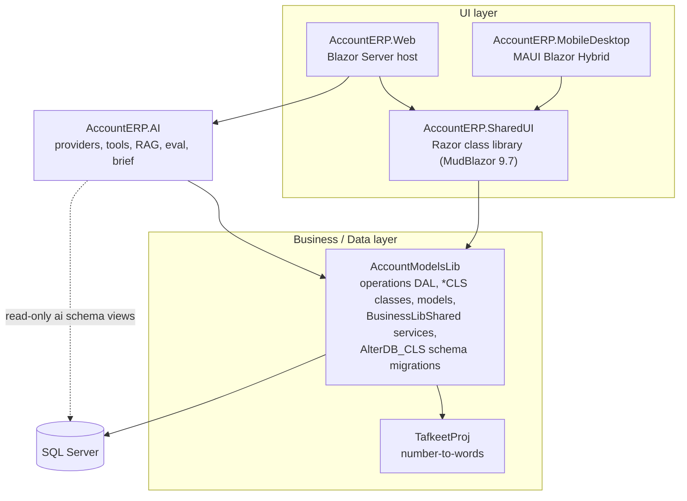

# Account ERP — WinForms to Blazor/MAUI Modernization

[](https://github.com/mohsaleh2010/AccountERP-Modernization/actions/workflows/build.yml)


A large, long-lived Egyptian ERP/accounting system (general ledger, multi-branch and multi-currency accounting, inventory, sales and purchasing, e-invoicing, and more). It is being moved screen by screen from a WinForms desktop application to **Blazor Server + MudBlazor**, with a **.NET MAUI Blazor Hybrid** shell for desktop and mobile. The new UI reuses the same business/data library as the legacy application, so the database schema and business rules stay identical.

The work is done with AI coding agents (Claude Code) in the terminal. A rules file, split documentation, subagents, and phase plans with user-run test IDs guide the agents. This repository showcases the modern stack, its documentation, and the AI-assisted workflow. The original WinForms solution is private and is not included.

## Highlights

- **Real production ERP** for Egyptian businesses. The modules (documented in `docs/overview.md`) are General Ledger, multi-branch/multi-currency accounting, inventory, sales/purchasing, Egyptian e-invoicing, car workshop, tourism/reservations, textile production, construction, HR, POS, and a beauty center.
- **Arabic-first, RTL-aware UI.** Resource files exist for `ar`, `en`, `de` and `fr` (`Razors/AccountERP.SharedUI/Resources/SharedUIAssemblyMarker.*.resx`). The default culture is `ar-EG`. Direction (RTL/LTR) switches at runtime on Web and MAUI.
- **Permission system carried over** from the desktop app. The navigation menu is built from the user's real permission tables (`SysConfigMenus` / `SysConfigMenusPERMATIONS`), not from hard-coded links.
- **Shared UI.** `AccountERP.SharedUI` runs on both a Blazor Server host and a MAUI Hybrid host, with light/dark themes and a tabbed workspace.
- **Built-in AI assistant** (`AccountERP.AI`): multi-provider streaming chat, validated read-only SQL, reports, invoice drafts, document extraction, a knowledge index, an evaluation suite, a daily manager brief, and a Ctrl+K command palette.
- **Documented schema and screens.** `ERP_V1_3.md` is the canonical DB and business-rules reference. `FORMS_INVENTORY.md` catalogs every screen.

## Architecture



Only the Web host references `AccountERP.AI`. The LLM packages therefore stay out of the shared UI library, which MAUI also uses.

| Project | Purpose |
|---|---|
| `Razors/AccountERP.SharedUI` | Razor class library: pages, dialogs, layout, tab workspace, localization, menu/permission services, assistant UI (`net10.0`). |
| `Razors/AccountERP.Web/AccountERP.Web` | Blazor Server host: auth, culture and theme endpoints, background workers (`net10.0`). |
| `Razors/AccountERP.Web/AccountERP.Web.Client` | Client project referenced by the Web host. |
| `Razors/AccountERP.MobileDesktop` | MAUI Blazor Hybrid shell (Android, plus Windows on Windows hosts). |
| `Razors/AccountERP.AI` | AI assistant backend: providers, tools, SQL validator, knowledge, evaluation, daily brief. |
| `Razors/AccountERP.SalesRepApp` (+ `.Core`) | Field-sales (sales representative) app and its core library. |
| `AccountModelsLib` | Shared business/data library: `operations` DAL, `*CLS` wrappers, models, `BusinessLibShared` services, `AlterDB_CLS` schema upgrades. |
| `TafkeetProj` | Number-to-words ("tafkeet") helper used by the business library. |

## Migrating from WinForms to Blazor

**Why.** The legacy system is desktop-only. It is built from MDI WinForms screens and is hard to deploy and update across many customer machines. It needed web, mobile and cross-platform desktop access, without rewriting accounting rules that years of real use have validated.

**The strategy** (see `Razors/MODERNIZATION_NOTES.md`, `CLAUDE.md` and `docs/`):

1. **Reuse, don't reimplement.** A Blazor screen calls the same `*CLS` wrappers and `operations` DAL methods as its WinForms equivalent, so saving data behaves the same on both UIs.
2. **One shared library.** `AccountModelsLib` is used by both the desktop app and the new UI. It has conditional targets for `net10.0-windows`, `net10.0`, `net10.0-android` and `net48`. The legacy solution dual-targets `net10.0-windows;net48` during the migration.
3. **Same DB schema and permission tables.** No table, column or model property is renamed. `ERP_V1_3.md` is the contract, typos included.
4. **Menu-driven, one screen at a time.** Each menu row in `SysConfigMenus` carries a `RazorPath`. `KnownRoutes` discovers every `@page` route by reflection. A menu item whose screen is not built yet shows an "under construction" page, so screens that are not migrated yet never break the app.
5. **A tab workspace replaces MDI** (`TabHost.razor` in the shared layout).
6. **Schema changes are code.** `AlterDB_CLS` classes apply idempotent upgrades at startup or from the admin tool.
7. **User-run test plans.** Each migrated screen gets numbered tests, tracked in a master test plan and in per-feature plans.

| WinForms concept | Blazor equivalent |
|---|---|
| MDI parent form with child windows | Tab workspace (`TabHost`) in the shared layout |
| Menu strip driven by permission tables | Navigation menu built from `SysConfigMenus` + permissions |
| Form opened with `new Form(args).Show()` | Routed `@page` component with route parameters |
| Form code-behind calling `*CLS` | Component/service calling the same `*CLS` / `operations` |
| `MessageBox.Show` error handling | Same try/catch pattern, shown through MudBlazor dialogs/snackbars |
| Per-machine installation | Web host, plus the MAUI Hybrid shell |
| Resource-based Arabic UI | `IStringLocalizer` with `ar/en/de/fr` resx and a runtime RTL switch |

## AI assistant module

All of the following is in `Razors/AccountERP.AI` and the shared UI:

- **Chat with streaming** through provider adapters: Anthropic, OpenAI-compatible, Gemini, Azure, Ollama, LM Studio, OpenRouter, and custom endpoints. Includes OpenRouter sign-in, connection testing, model listing, and encrypted API keys (`AiKeyProtector`, `AiUrlPolicy`).
- **Tool registry**: `search_schema`, `run_readonly_query`, `find_entity`, `get_periods_and_branches`, `get_trial_balance`, `get_financial_statement`, `render_report`, `open_screen`, `find_screen`, `extract_document`, and more.
- **Read-only SQL.** `ReadOnlySqlExecutor` parses each query with **ScriptDom** (`TSql160Parser`) and accepts only a single `SELECT`. It rejects `INTO`, `OPENROWSET`/`OPENQUERY`, schema-qualified functions, and three- or four-part names. Queries run over views in a dedicated `ai` schema under a read-only login (`docs/ai-readonly-login.sql`).
- **Reports and charts** through `AiReportEngine` / `render_report`, with Excel export.
- **Drafts.** `AiDraftTools` creates sales/purchase invoice and store-order drafts, which the user reviews and saves in the normal screens.
- **Document extraction**: `AiDocumentExtractor`, `AiExtractionNormalizer`, and an attachment store.
- **Knowledge / RAG**: `AiKnowledgeIndex`, `AiKnowledgeService`, `AiEmbeddingService`.
- **Evaluation suite**: seed cases, a runner, a judge, and a compare/run UI (`AiEval*`).
- **Feedback** collection (`AiFeedbackGateway`).
- **Daily manager brief**: collector, alerts, narrator, and a scheduled job run by a hosted worker (`AiBrief*`).
- **Ctrl+K command palette** (`CommandPalette.razor`).
- The assistant schema is created by `AlterDB_CLS/AiAssistantSchemaCLS.cs`.

## AI-assisted development workflow

This project is developed with Claude Code in the terminal. The repository includes the scaffolding that keeps that reliable:

- **`CLAUDE.md`** is a short rules file that is always loaded. Examples: never rename DB objects, verify foreign keys before assuming them, check for near-duplicate forms, reuse the existing DAL, never write secrets, follow the invoice tax-flag rules, and check stock in invoice tests. It points to a documentation index that is read only when needed.
- **`docs/`** splits `CLAUDE.md` into topics (`overview`, `projects`, `technology-stack`, `database`, `architecture`, `coding-naming`, `configuration`, `known-constraints`, `dev-rules`, `investigations`).
- **`.claude/agents/`** holds focused subagents, such as `razor-editor`, `razor-tester` and `descriptor`.
- **`.claude/docs/`** holds the phase plans (menus, invoices, cash vouchers, journal entries, cost centers, inventory, field sales, AI assistant P0–P8). Each plan records decisions, open questions and numbered test IDs. The folder also has a work log, an open-work index and a master user-test plan.
- **Plan with one model, code with another.** A planning session writes the plan and its decisions. A separate coding session then implements it one phase at a time, and each commit references its phase.
- **Large reference files** (`ERP_V1_3.md`, `FORMS_INVENTORY.md`) are searched with grep and read in ranges, never loaded whole.

## Getting started

**Prerequisites:** .NET 10 SDK, SQL Server (with the ERP database), and either Visual Studio 2022/2026 or the `dotnet` CLI. The MAUI project also needs the MAUI workload.

```bash
git clone <this-repo-url>
cd <repo-folder>
```

The web app reads its connection string from `ConnectionStrings:DefaultConnection`. Keep real values out of source control and set it like this:

```powershell
# PowerShell, using an environment variable
$env:ConnectionStrings__DefaultConnection = "Server=<server>;Database=<database>;User Id=<user>;Password=<password>;TrustServerCertificate=True"
```

```bash
# or with user-secrets
cd Razors/AccountERP.Web/AccountERP.Web
dotnet user-secrets init
dotnet user-secrets set "ConnectionStrings:DefaultConnection" "Server=<server>;Database=<database>;User Id=<user>;Password=<password>;TrustServerCertificate=True"
```

Build and run:

```bash
dotnet build Razors/AccountERP.Web/AccountERP.Web/AccountERP.Web.csproj
dotnet run --project Razors/AccountERP.Web/AccountERP.Web
```

This repository does not include a database. The app builds without one, but it needs a SQL Server database that matches `ERP_V1_3.md` to run.

## Repository layout

```
.
├── CLAUDE.md                 # always-loaded rules for the AI agent
├── ERP_V1_3.md               # canonical DB schema / business rules
├── FORMS_INVENTORY.md        # per-screen catalog and navigation map
├── docs/                     # topic docs split from CLAUDE.md
├── .claude/
│   ├── agents/               # subagent definitions
│   └── docs/                 # phase plans, decisions, test plans, work log
├── AccountModelsLib/         # shared business/data library
├── TafkeetProj/              # number-to-words helper
└── Razors/
    ├── MODERNIZATION_NOTES.md
    ├── Directory.Build.props
    ├── AccountERP.SharedUI/
    ├── AccountERP.Web/       # AccountERP.Web + AccountERP.Web.Client
    ├── AccountERP.MobileDesktop/
    ├── AccountERP.AI/
    ├── AccountERP.SalesRepApp/
    └── AccountERP.SalesRepApp.Core/
```

## Status and roadmap

- The migration is in progress. Accounts, journal entries, invoices, cash vouchers, inventory/items, financial statements and field sales already have Blazor screens. Other menu items still show "under construction".
- The AI assistant phases P0 to P8 are implemented: chat, read-only Q&A, reports, drafts, document extraction, knowledge/RAG, evaluation, daily brief, Ctrl+K search, and in-screen "explain" actions. Their user test runs are scheduled next.
- Several test plans are still waiting to be run by the user.

## Notes on this public copy

- Connection strings, passwords, server names and customer-specific identifiers were removed or anonymized from the code and its history.
- The legacy WinForms projects, third-party samples and binaries are not included.

## License

All rights reserved. Shared for portfolio review.

## Author

Mohammed Saleh
